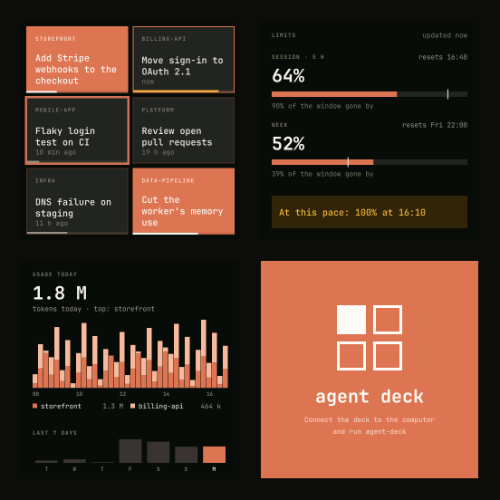
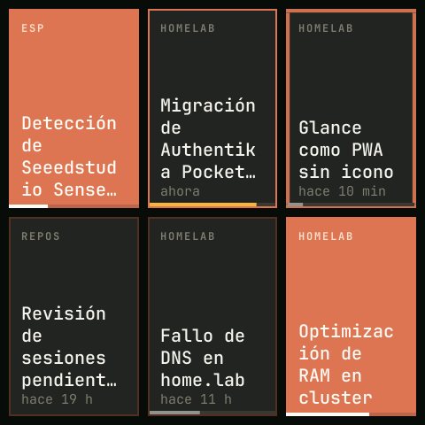
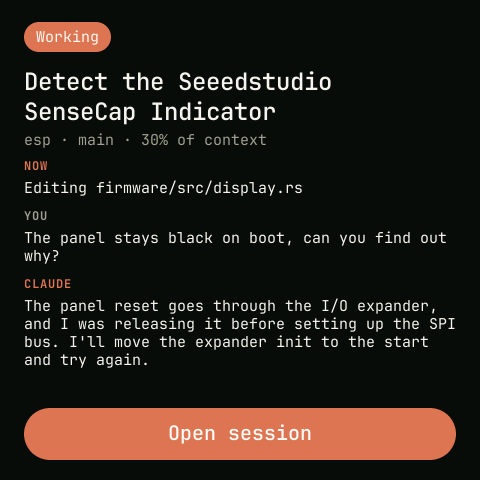
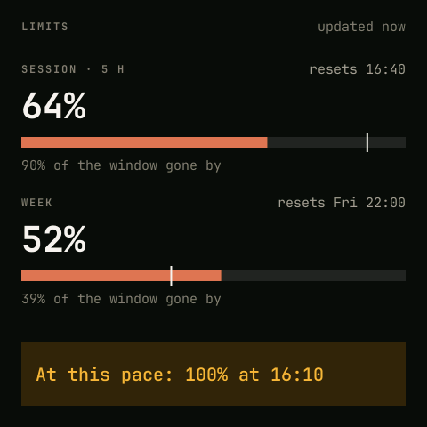
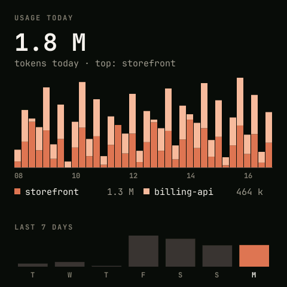

# agent deck

[](https://github.com/sverdejot/agent-deck/actions/workflows/ci.yml)
[](#license)

A desk display for [Claude Code](https://claude.com/claude-code): a SenseCAP Indicator D1 that
shows the sessions running in your Mac's terminal, tells you which one needs you, and brings the
one you tap to the front.

<p align="center"></p>

## Screens

| | |
|---|---|
|  | **Sessions** — one tile per session; the grid adapts from 1 to 9 tiles (rows up to 3, then 2×2, 2×3 and 3×3, all tiles the same size), then pages. Orange = working, pulsing border = needs you, orange border = finished recently, faint = idle. Repo on top, context-window bar at the bottom. **Tap** to focus the session's tmux pane in Ghostty. |
|  | **Summary** — hold a tile: what it is doing now, your last message and Claude's last reply, read from the transcript. When Claude is waiting on you (a question, a permission, a plan approval) it shows the question with one button per option: **tap** one to answer without leaving what you're doing (tmux sessions). |
|  | **Limits** — 5-hour and weekly plan usage, when they reset, how much of each window has passed, and when you'd hit 100% at the current pace. |
|  | **Usage** — today's tokens in 15-minute bars per repo, and the last 7 days. |

The side button cycles screens (long press dims). Without the Mac, the deck shows the offline
screen.

## Requirements

- [SenseCAP Indicator D1](https://www.seeedstudio.com/SenseCAP-Indicator-D1-p-5643.html) (ESP32-S3 + 4" 480×480 touch screen), connected over USB.
- macOS, with Claude Code running in **tmux** inside **Ghostty** (other terminals are not supported yet).
- A Claude subscription for the Limits screen (the data comes from Claude Code's statusline).

## Install

**Firmware** — flash it from the browser (Chrome or Edge) at
**[sverdejot.github.io/agent-deck](https://sverdejot.github.io/agent-deck/)**, picking the
CH340 serial port. Or build it yourself: `mise run fw:flash`.

**Mac agent**:

```sh
mise use -g github:sverdejot/agent-deck   # or download it from the latest release
agent-deck install-statusline             # record plan limits and context from the statusline
agent-deck install                        # run at login (LaunchAgent)
```

The first time, macOS asks to let `agent-deck` control Ghostty. Everything is read locally from
`~/.claude`; nothing leaves your machine. `agent-deck uninstall-statusline` and
`agent-deck uninstall` undo both steps.

## Development

```
firmware/         ESP32-S3 firmware (Rust, esp-idf)
crates/deck-ui/   screens, layout and protocol (Rust, runs and tests on the host)
host/             Mac agent (Go)
docs/protocol.md  serial protocol
```

Requires [mise](https://mise.jdx.dev) and rustup; every tool version is pinned.

```sh
mise install && mise run setup   # tools + Xtensa toolchain
mise run check                   # what CI runs
mise run ui:snapshots            # render every screen to PNG, no device needed
mise run fw:flash                # flash the deck (stop agent-deck first: it holds the port)
```

## Limitations

- macOS only; focusing a session needs tmux + Ghostty, answering its questions needs tmux.
- The deck's labels are in Spanish.
- Only sessions started from a terminal are shown (not the Claude desktop app or claude.ai).

## License

Licensed under either of [Apache License, Version 2.0](LICENSE-APACHE) or [MIT license](LICENSE-MIT)
at your option. JetBrains Mono is under the [SIL Open Font License](crates/deck-ui/assets/fonts/OFL.txt).
The display init sequence follows Seeed Studio's
[SenseCAP_Indicator_ESP32](https://github.com/Seeed-Solution/SenseCAP_Indicator_ESP32) BSP.

Not affiliated with or endorsed by Anthropic. Claude and Claude Code are trademarks of Anthropic.
